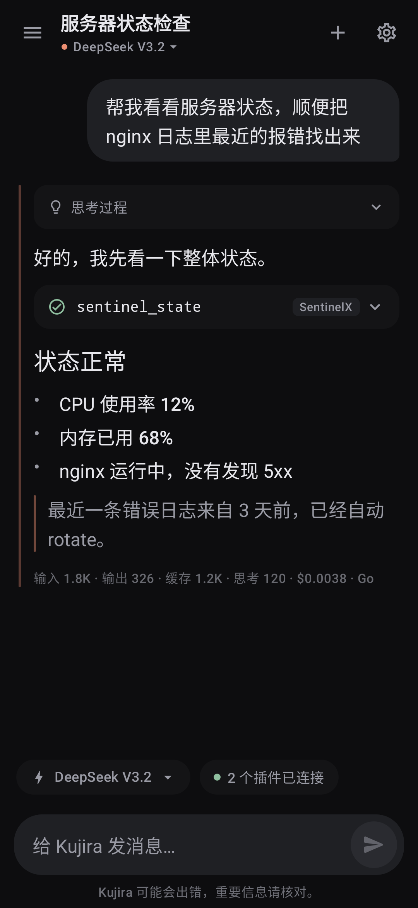
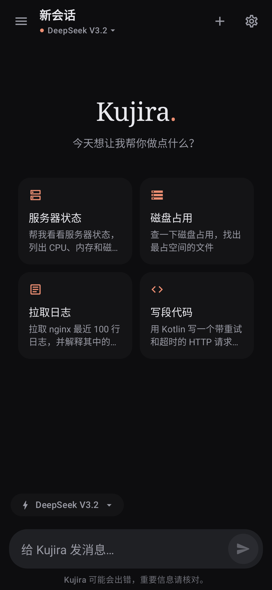
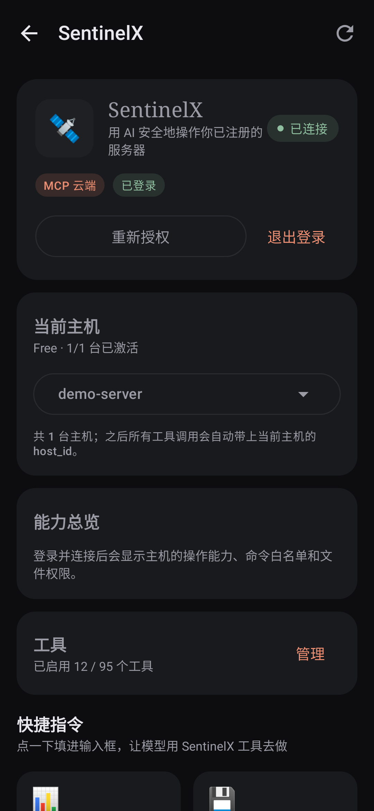
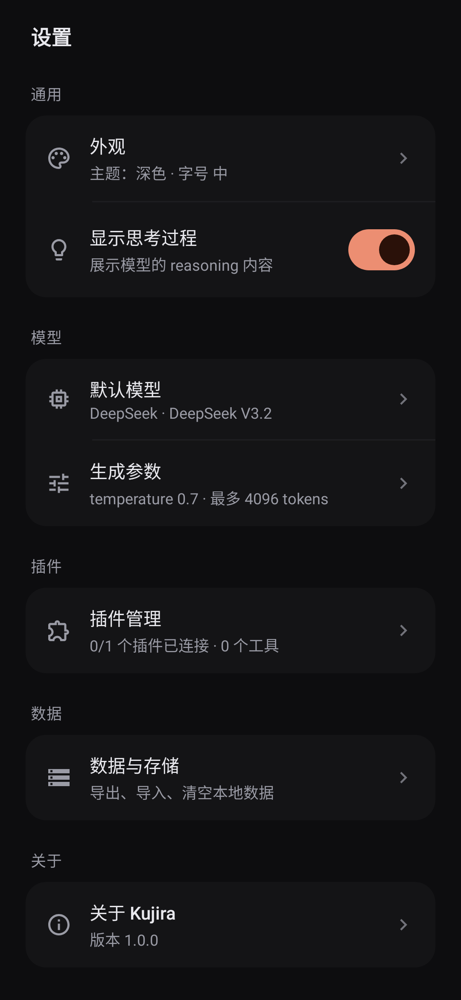
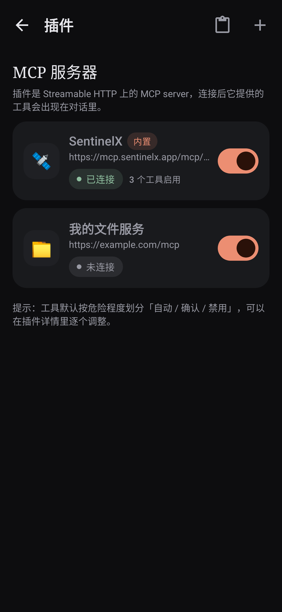
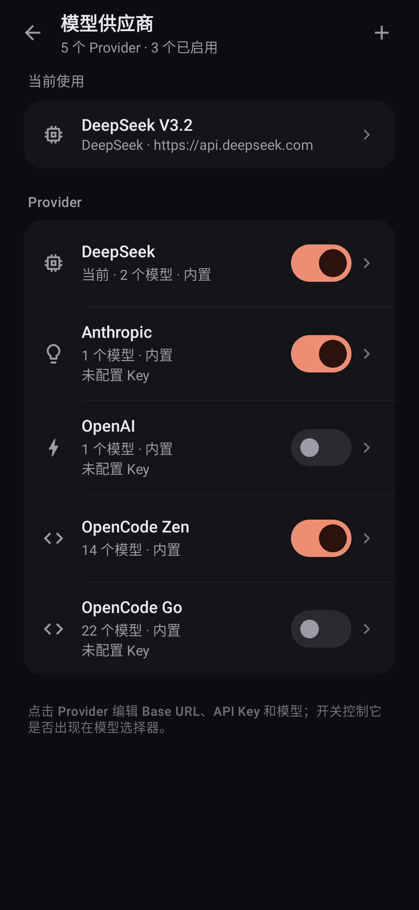
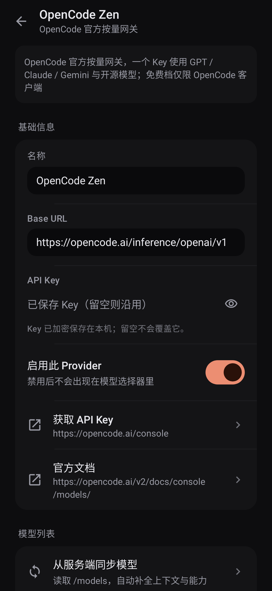

# Kujira 🐋

一个装在 Android 手机上的 AI 助手客户端 —— 布局学 ChatGPT，气质学 Claude，
通过 **MCP（Model Context Protocol）** 支持自定义插件，并原生适配
[SentinelX](https://sentinelx.app) 服务器控制。

> 给「蓝色大肥鱼」自己做的小工具。深色墨黑 + 陶土橙，衬线标题，克制动效。

<p align="center">
  
  
  
</p>
<p align="center">
  
  
</p>
<p align="center">
  
  
</p>

## 功能

- **多模型对话**：DeepSeek / OpenAI / Anthropic / OpenRouter / **OpenCode Zen** /
  **OpenCode Go** / 任意 OpenAI 兼容端点
- **模型供应商管理**：内置 12 个 provider 预设、启用开关、Key 状态、官方文档与取 Key 入口；
  **从服务端 `/models` 一键同步模型**，自动补全上下文窗口、工具 / 视觉 / 思考能力
- **流式回复**：SSE 增量渲染、随时停止、Markdown（标题/列表/表格/代码块高亮/复制）
- **会话管理**：本地 SQLite、分组历史、置顶、重命名、搜索、**JSON 导出/导入备份**
- **消息操作**：复制、编辑并重发、重新生成、删除、失败重试
- **工具调用**：LLM function calling ↔ MCP tools/call 多轮循环，聊天内工具卡片
- **自定义插件**：任意 MCP server（Streamable HTTP），支持 Bearer / OAuth / 自定义 Header，
  可粘贴 `mcpServers` JSON 导入；每个工具可单独设为 自动 / 询问 / 禁用
- **SentinelX 深度适配**：
  - 内置插件 + 一键 OAuth 登录（Keycloak PKCE + 本地 loopback 回调，与桌面端 bridge 一致）
  - 95 个工具按前缀自动分组，默认只开安全子集（避免 context 爆炸）
  - 主机选择器：登录后拉取主机列表，所有工具调用自动注入 `host_id`
  - 能力总览、错误人话解释、工具调用审计日志
- **安全**：API Key / OAuth token 用 Android Keystore AES-GCM 加密存储，不落明文

## 构建

环境：JDK 21、Android SDK（platform 37 + build-tools 37）、Gradle 9.6.1。

```sh
./gradle.sh assembleDebug          # 产出 app/build/outputs/apk/debug/app-debug.apk
./gradle.sh installDebug           # 装到已连接设备
```

`gradle.sh` 是本地 launcher，已内置 `ANDROID_HOME` / `JAVA_HOME` 与 Gradle 9.6.1 路径。

### 版本锁定（别乱动）

| 组件 | 版本 | 说明 |
| --- | --- | --- |
| AGP | 9.5.0 | 内置 Kotlin 2.2.10 支持，`compileSdk = 37` 必需 |
| Gradle | 9.6.1 | 与 AGP 9.5 匹配 |
| Kotlin | 2.2.10（AGP 内置） | 所以不能再用 `org.jetbrains.kotlin.android` 插件 |
| Compose BOM | 2025.12.01 | 更新的 BOM 要求 AGP 9.1+ 的 Kotlin 2.4 metadata |
| compileSdk / targetSdk / minSdk | 37 / 36 / 26 | |

> 踩坑记录：2026 下半年的 AndroidX/Compose 库用 Kotlin 2.4 编译，而 AGP 9.5 内置编译器是
> Kotlin 2.2，读不了 2.4 metadata。要么升级到 AGP 9.1+ 的 Kotlin（当时不可行），要么把库
> 钉在 2025.12 一代。对功能性没有影响。

## 配置

### 1. 加 API Key 与模型

设置 → 模型 → Provider 与 API Key：

1. 右上角 `+` 选择预设（OpenCode Zen / OpenCode Go / DeepSeek / OpenAI / Anthropic /
   OpenRouter，以及 Gemini、xAI、Groq、Mistral、Kimi、GLM 等）；
2. 填 API Key，点「获取 API Key」可直接打开官方控制台；
3. 点「从服务端同步模型」拉取 `/models`，自动补全上下文与能力；
4. 打开「启用此 Provider」，保存后回到模型页选中它。

Key 存在 Keystore 加密的 SharedPreferences 里。

**OpenCode** 两个网关都使用 OpenAI Chat Completions 兼容地址：

| Provider | Base URL | 说明 |
| --- | --- | --- |
| OpenCode Zen | `https://opencode.ai/inference/openai/v1` | 按量付费，GPT / Claude / Gemini / 开源模型 |
| OpenCode Go | `https://opencode.ai/inference/go/openai/v1` | $10/月订阅，开源编码模型 |

两个网关共用 `https://opencode.ai/inference/v1/models` 模型目录，密钥来自
[OpenCode Console](https://opencode.ai/console)。Kujira 会按文档发送稳定的
`x-opencode-session`（每个会话一个），Go 的路由与 prompt cache 都依赖它。
免费档聊天模型只允许在 OpenCode 内使用，第三方客户端会收到 403——请选付费模型或 Go。

### 2. 连 SentinelX

设置 → 插件 → SentinelX → 登录：

1. app 在本机 `127.0.0.1:20573` 起一次性回调 server；
2. Custom Tabs 打开 Keycloak 授权页（`https://keycloak.pensa.ar/realms/mcp`）；
3. 用 Google 登录并同意 scope（`sentinelx:exec` 等）；
4. 回调带 `code` → 换 token → 加密保存；refresh token 失效时才需要重新登录。
5. 连上后 → 选择主机（`sentinel_list_hosts`）→ 工具分组里挑要启用的工具。

### 3. 自定义插件

设置 → 插件 → 添加。远程 MCP server 填 URL；也可以用「导入」粘贴 Claude Desktop 风格的
`mcpServers` JSON。

## 架构

```
data/model     领域模型（Conversation/Message/ContentBlock/PluginConfig/...）
data/db        SQLite（conversations / messages / tool_audit）
core           SecureStore（Keystore 加密）、SettingsStore、ProviderPresets（Provider 预设目录）
net/llm        LlmClient 接口 + OpenAI 兼容 / Anthropic SSE 客户端 + LlmRouter
               + ModelCatalogClient（`/models` 拉取、能力解析与合并）
domain         ChatEngine（工具调用循环）、ToolExecutor 接口、ProviderRepository
net/mcp        JSON-RPC 2.0、Streamable HTTP 传输、McpClient、McpManager、OAuth PKCE
net/sentinelx  SentinelX 预设/主机/工具分组/错误解释
ui/chat        聊天界面、Markdown 渲染器、消息气泡、工具卡片
ui/sessions    会话抽屉
ui/plugins     插件管理与工具开关
ui/settings    Provider 列表 / 预设选择 / 模型同步 / 设置
ui/theme       配色与字体（墨黑 + 陶土橙 / 暖纸）
di             AppContainer（手写 DI）
```

## 致谢 / 参考

Provider 这一轮的设计大量参考了这些开源项目（只借鉴做法，没有拷贝它们的 UI 资产）：

- [OpenCode](https://github.com/anomalyco/opencode) —— Zen / Go 网关地址、模型目录、
  `x-opencode-session` 与各模型的原生 API surface，以官方 docs 源码为准；
- [models.dev](https://github.com/sst/models.dev) —— 模型上下文、输出上限、工具 / 视觉 /
  思考能力与 temperature 支持情况；
- [RikkaHub](https://github.com/rikkahub/rikkahub) —— Provider 列表、预设推荐 Sheet、
  模型列表同步与连接测试的交互；
- [Chatbox](https://github.com/chatboxai/chatbox) —— OpenCode 会话头、模型元数据与
  按模型能力发送请求参数的处理；
- [Cherry Studio](https://github.com/CherryHQ/cherry-studio) —— Provider 预设与模型同步的产品结构。

其他：

- 桌面端 SentinelX MCP bridge：`~/Desktop/dsh-plugins/sentinelx-mcp/bridge.mjs` —— OAuth 流程与
  协议细节以它为准。
- MCP 规范：Streamable HTTP transport。
